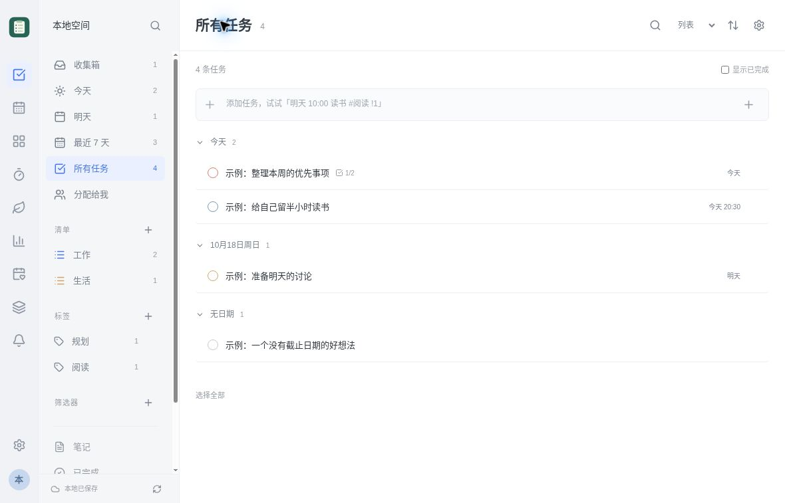
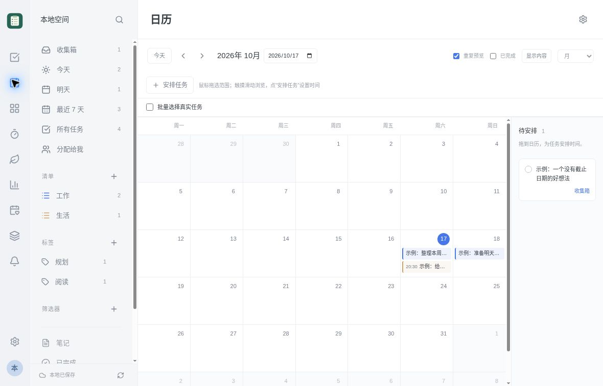
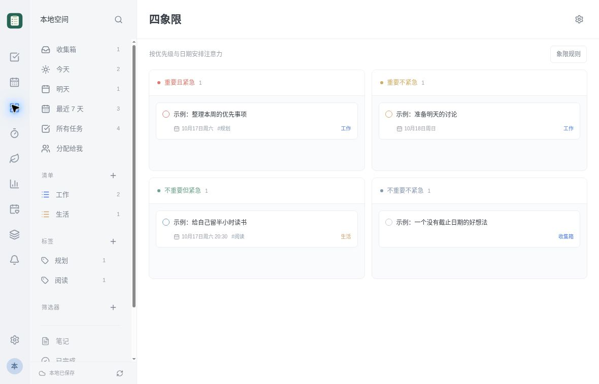
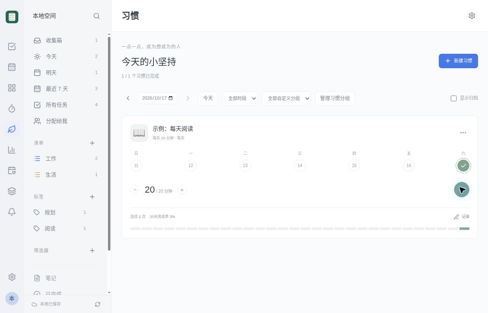

# 青单

青单是可在本机或自有服务器运行的任务与时间管理应用，把清单、日历、习惯和专注计时放在一个工作台。支持免登录的本机使用，也可部署私服，在多台设备间同步。

[下载发行版](https://github.com/AaronJny/qingdan/releases/latest) · [界面截图](#界面截图) · [从源码运行](#从源码运行) · [部署与开发文档](#部署与开发文档)

## 主要功能

- **任务与笔记**：清单、文件夹、子任务、检查项、标签、优先级、富文本与 Markdown 描述
- **计划与视图**：列表、看板、日历、时间线、四象限，支持日期、时间、重复规则和提醒设置
- **习惯与专注**：习惯目标与打卡、番茄计时、正计时、专注记录与统计
- **日常工具**：模板、倒数日、搜索与自定义筛选
- **协作与附件**：私服账号、共享清单、成员权限、评论、动态与附件
- **数据管理**：JSON、CSV、ICS 导入导出，包含附件的完整备份，可见的同步状态与冲突核对

协作能力需要账号模式私服。本机模式不需要登录；切换私服不会自动上传、合并或迁移本机数据。

## 界面截图

### 任务工作台

按日期安排任务，用清单和标签整理工作与生活。



<details>
<summary>查看日历、四象限和习惯截图</summary>

### 日历安排

月历展示已有任务，右侧保留待安排事项。



### 四象限

按优先级与日期整理注意力，并可配置象限规则。



### 习惯打卡

查看每日目标、当周记录、连续次数与近 30 天完成情况。



</details>

## 下载与安装

前往 [Releases](https://github.com/AaronJny/qingdan/releases/latest) 下载适合自己系统的版本。当前发行版为 [v1.1.1](https://github.com/AaronJny/qingdan/releases/tag/v1.1.1)，包含桌面端、服务端和 Android 客户端。

| 平台 | 下载 | 使用方式与要求 |
| --- | --- | --- |
| macOS · Apple Silicon | [arm64 DMG](https://github.com/AaronJny/qingdan/releases/download/v1.1.1/Qingdan-1.1.1-mac-arm64.dmg) | macOS 13 及以上；正常退出旧版后，将应用拖入 Applications。暂不支持 Intel Mac |
| Windows · x64 | [便携 ZIP](https://github.com/AaronJny/qingdan/releases/download/v1.1.1/Qingdan-1.1.1-win-x64.zip) | 完整解压后运行 `Qingdan.exe`，不要只复制 EXE |
| Linux · x64 | [AppImage](https://github.com/AaronJny/qingdan/releases/download/v1.1.1/Qingdan-1.1.1-linux-x64.AppImage) | 需要图形桌面与正常可用的 Electron 沙箱；添加可执行权限后运行，FUSE 替代启动方式见[桌面说明](desktop/README.md) |
| 自托管服务端 / 网页端 | [含运行时 ZIP](https://github.com/AaronJny/qingdan/releases/download/v1.1.1/qingdan-server-v1.1.1.zip) | 内置 Linux x64 / macOS arm64 运行时和启动脚本，无需另外安装 Node.js 或 npm |
| Android | [0.1.1 APK](https://github.com/AaronJny/qingdan/releases/download/v1.1.1/Qingdan-0.1.1-android.apk) | Android 8.0 及以上，并需保持系统 WebView 更新；安装与签名注意事项见[Android 说明](android/README.md) |

下载后可使用发行版附带的 SHA256 校验文件检查文件完整性。

### 已知平台限制

- macOS 版本尚无 Developer ID 签名或 Apple 公证，Windows 版本尚无发布者签名，系统可能阻止运行。遇到安全警告时，请先核实下载来源，保留系统安全设置。
- Android 新签名不能覆盖旧签名安装。升级前先在旧应用中导出完整备份；不要直接卸载旧应用，卸载会删除其私有数据。
- 提醒和计时铃声需要保持应用页面打开且可见。Android 暂不支持后台推送或准点闹钟。

## 本机模式与私服模式

### 本机使用

桌面端会自动启动内置服务，无需安装 Node.js、手动运行命令或输入账号密码。任务与附件保存在本机用户目录。

服务端 ZIP 也可作为本机网页版使用：解压后阅读根目录的运行说明，macOS 运行 `start.command`，Linux 运行 `start.sh`，并在服务运行期间使用浏览器访问本机地址。

**免登录本机模式只允许回环访问，不应通过反向代理、隧道或公网端口向外公开。**

### 连接自有服务器

使用账号模式部署服务后，桌面端可从“设置 → 账号与同步 → 服务器连接”或菜单“文件 → 服务器连接”（`Cmd/Ctrl+,`）填写服务器地址，再使用该服务器创建的账号登录。远程私服需要有效证书的 HTTPS 根地址；桌面端允许字面回环地址使用 HTTP。Android 私服连接仅支持 HTTPS。

账号模式没有默认密码或公开注册，需要在部署机器的交互终端初始化管理员。不同服务器、不同账号与本机模式的数据身份和缓存相互隔离，不会自动相互迁移。部署步骤与 HTTPS 配置见[服务端配置](application/README.md)和[账号说明](application/AUTH.md)。

## 从源码运行

需要 **Node.js 24** 和 npm。在仓库根目录执行：

```sh
cd application
npm ci
npm run build
npm start
```

打开 `http://127.0.0.1:4310`，默认进入仅本机可访问的单人模式。默认数据目录为 `application/data/local`，可通过 `QINGDAN_DATA_DIR` 指定独立目录。

返回仓库根目录后，另行运行完整源码检查：

```sh
npm run check --prefix application
```

私服配置、环境变量、Docker Compose 和开发说明见 [application/README.md](application/README.md)。

## 数据与备份

- **桌面端**：稳定用户目录为系统应用数据目录下的 `QingdanDesktop`，本机数据库与附件位于其中的 `local-data`。备份前正常退出应用，再完整复制用户目录；升级时保留该目录。
- **独立服务端**：先停止服务，再完整备份实例数据目录，包括 SQLite、对象文件和模式标记。不要在运行时只复制 SQLite 主文件，也不要复用本机与账号模式的数据目录。
- **Android**：卸载或系统清除数据会删除应用私有数据，请提前通过应用导出完整备份。
- 应用内任务导出不包含登录密码或会话；实例目录备份可能包含账号与会话等私密信息，应自行妥善保管。

## 部署与开发文档

| 目录 / 文档 | 内容 |
| --- | --- |
| [application/](application/README.md) · [账号说明](application/AUTH.md) | React 前端、Node.js 服务、数据库迁移、账号与部署配置 |
| [desktop/](desktop/README.md) · [构建流程](desktop/docs/BUILD-RELEASE.md) | Electron 桌面封装、内置后端和各平台打包 |
| [android/](android/README.md) · [签名设置](android/docs/RELEASE-SIGNING.md) | Android 原生容器、独立网页源码、构建与签名 |
| [server-packaging/](server-packaging/BUILD.md) | 含运行时的服务端 ZIP 与启动脚本 |
| [品牌资源](docs/BRANDING.md) | 网页、桌面与 Android 绿色剪贴板图标 |
| [前端第三方声明](application/docs/THIRD-PARTY-NOTICES.md) · [DMG 工具链声明](desktop/scripts/dmg/toolchain/THIRD-PARTY-NOTICES.md) | 分发时需要保留的第三方许可与声明 |

### 检查与发行

推送到 `main` 会运行[完整检查工作流](.github/workflows/check.yml)。发布请求通过 [.github/release/request.json](.github/release/request.json) 指定版本；修改发布请求、推送对应版本 tag 或手动触发“青单发布”工作流才会构建发行，普通提交只做检查。

发行流水线要求 macOS、Windows、Linux、服务器和 Android 五类成品齐备，并附 SHA256 和独立检查报告。Android 签名未配置时，发行版会保留为草稿。签名密钥与密码应通过安全配置提供，不要写入源码、聊天或构建产物。

## 许可证

项目源码采用 **AGPL-3.0-only**，许可全文见 [LICENSE](LICENSE)。允许商业使用与合规分发；分发本软件（包括二进制）或提供修改后的网络服务时，应按许可证要求向相应接收者或网络用户提供对应源码。部署与分发前请阅读[许可范围与源码交付说明](application/docs/LICENSING.md)。

第三方依赖、图标库和构建工具继续遵循各自原有许可证，不被本项目许可证替换。分发时请同时保留相关许可与声明。对应源码应可供软件接收者或网络用户访问。
